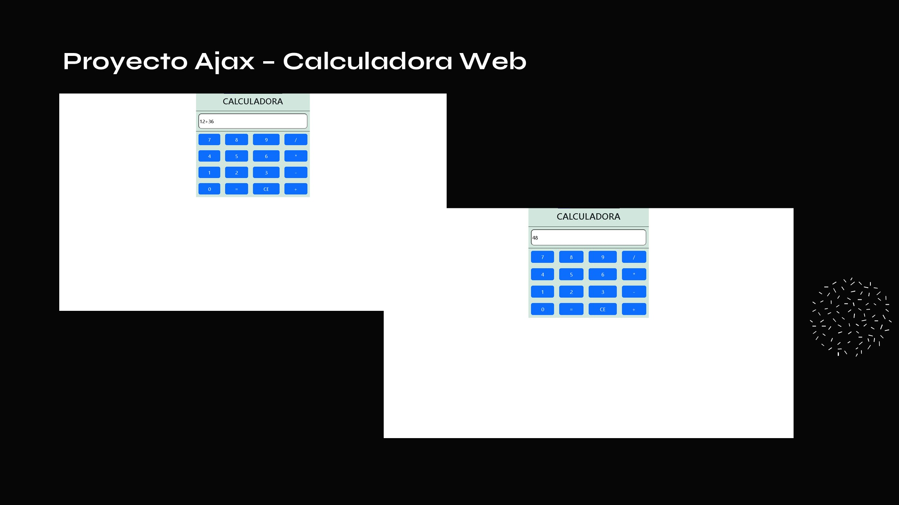

# Calculadora Web — JavaScript

Calculadora web interactiva para operaciones aritméticas básicas, desarrollada con **HTML5**, **CSS3**, **JavaScript** y **Bootstrap 5**.

## Vista previa

## Características principales

- Pantalla de solo lectura (`readonly`) para visualizar la expresión y el resultado.
- Teclado numérico (`0`–`9`) y operadores básicos (`+`, `-`, `*`, `/`).
- Evaluación de operaciones (`=`) y limpieza de pantalla (`CE`).

## Tecnologías utilizadas

- **HTML5**
- **CSS3**
- **JavaScript** (manipulación del DOM en el cliente)
- **Bootstrap 5.2.2** (vía CDN)

## Contexto y estado del proyecto

- **Contexto:** Práctica de desarrollo frontend con fines académicos.
- **Estado:** Finalizado (archivado para portafolio).

## Autor

**Daniel Alejandro Arita Leiva**
